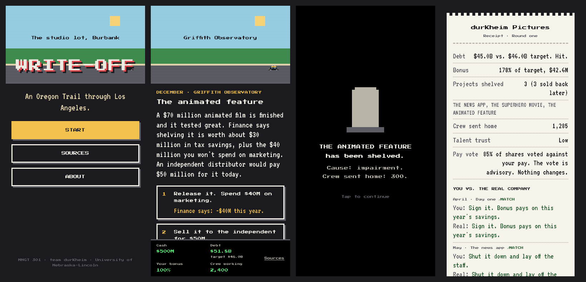
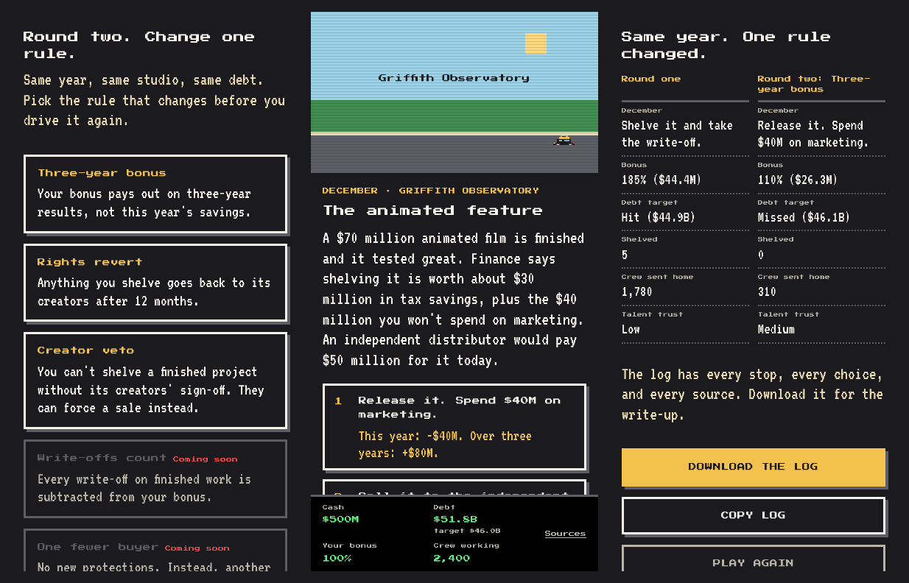
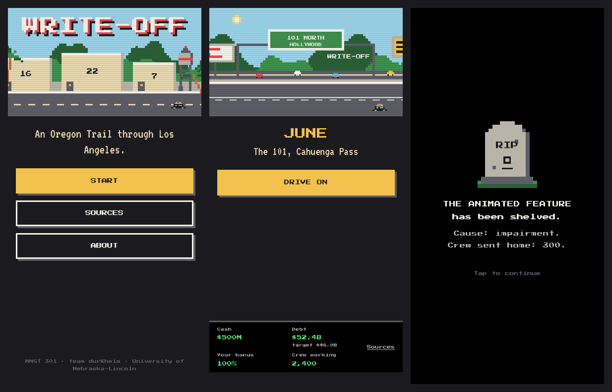
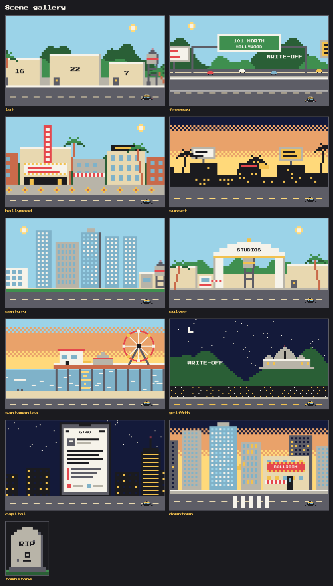
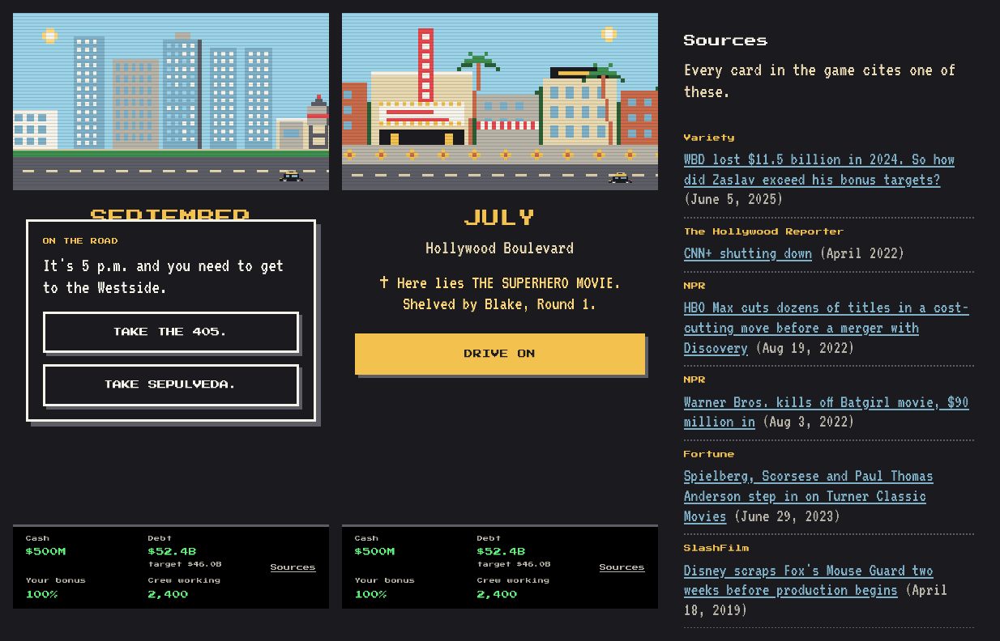
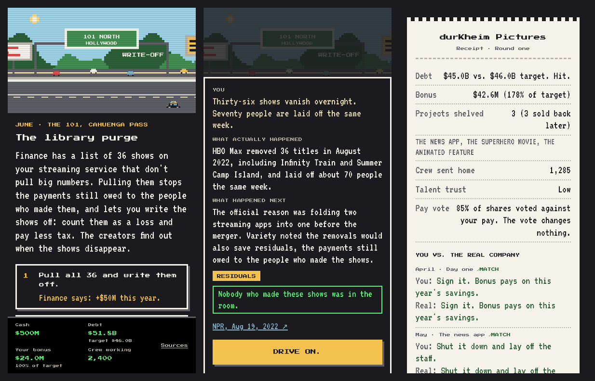
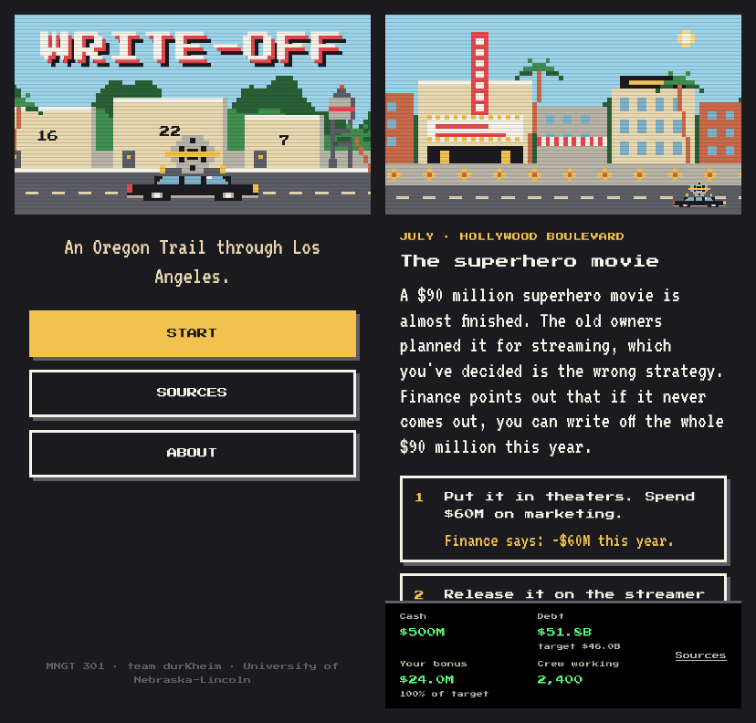
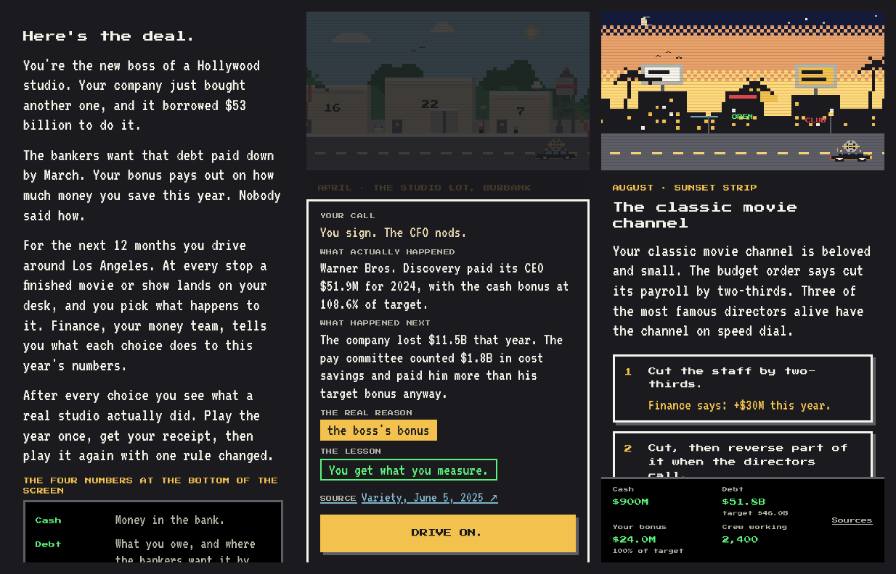
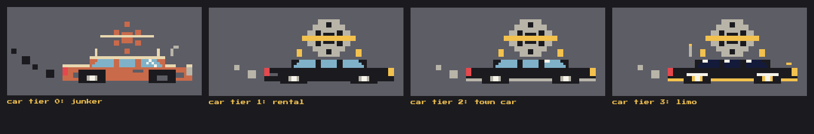
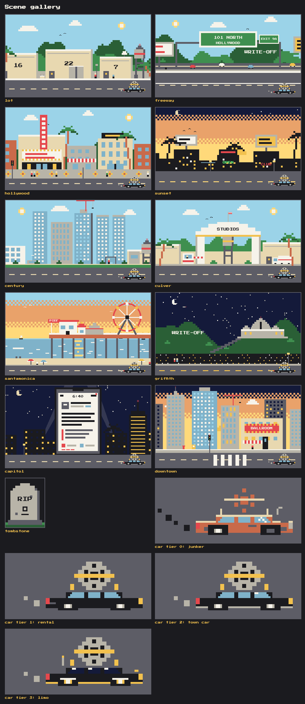

# Write-Off

An Oregon Trail style game about why studios shelve finished movies. MNGT 301 semester project, team durKheim, University of Nebraska-Lincoln, Fall 2026.

## Play it

Live at https://blakekahler.github.io/write-off/ (GitHub Pages). Or open `index.html` in any browser. Works on phones. Number keys 1 to 3 pick choices on a keyboard.

## What's in here

| File | What it is | Who touches it |
| --- | --- | --- |
| `CLAUDE.md` | Project rules for Claude Code | Blake |
| `SPEC.md` | The full game spec: screens, state, economics, visuals | Blake |
| `PROMPTS.md` | The build phases to paste into Claude Code, in order | Blake |
| `scenarios.js` | Every stop, choice, outcome card, source, random event and rule card | Writers |
| `index.html` | The engine and styles | Claude Code |
| `scenes.js` | The pixel LA backgrounds, the car and the tombstone | Claude Code, then the art teammate |
| `rules.js` | Round-two rule math | Claude Code |
| `test/play.js` | Optional Playwright script that plays both rounds and reports errors | Claude Code |
| `test/scenes.html` | A gallery page showing all ten scenes side by side | The art teammate |

## Editing content

Writers only edit `scenarios.js`. Each stop has a three-sentence `setup`, three `choices` with one-line labels, and a `card` with `did`, `next`, `driver`, `chip` and `source`. Keep the setups at three sentences, keep the choices to one line, and don't change a number on a card without a source. The dollar effects on choices (`thisYear`, `threeYear`, `writeOff`) are game numbers; if you change the December ones, run `checkFlip()` in the browser console to make sure round two still flips the decision.

## Deploying

The game is four static files at the repo root (`index.html`, `scenarios.js`, `scenes.js`, `rules.js`). All script tags are relative paths, so the same files work opened from a folder on your laptop and served from GitHub Pages.

The repo is https://github.com/blakekahler/write-off and Pages serves `main` from the root, so every `git push origin main` redeploys the site at https://blakekahler.github.io/write-off/ within a minute or two. That link is what we submit to Canvas.

If Pages ever needs to be set up again: Settings > Pages > Build and deployment > Source: Deploy from a branch > Branch `main`, folder `/ (root)` > Save.

## Testing

Open `index.html` and play a round. For the automated check, `test/play.js` plays both rounds in headless Chromium at phone width, prints the two receipts, runs `checkFlip()`, and fails if anything throws, if the page scrolls sideways, if a choice button is under 48px, or if an outcome card needs a scroll bar.

```
node test/play.js                  # full speed, screenshots in test/out/
FAST=1 node test/play.js           # reduced motion, no travel animation
R1=shelve R2=release RULE=rightsRevert node test/play.js   # pick strategies and the round-two rule
```

It needs Playwright with Chromium available to Node (`npm i -g playwright && npx playwright install chromium`). That is a tool on your machine, not a project dependency; the game itself has none.

`checkFlip()` also runs from the browser console on any screen.

## Build log

One entry per iteration, oldest first, each with screenshots captured from that iteration's commit at phone size. The detailed per-change table (every fix, every playtest) is in `LOG.md`.

### 1. The loop (Phase 1, Oct 27, 2026)

Title, setup with the pace choice, all twelve stops, the black "has been shelved" screen, the outcome card and the paper receipt, with flat placeholder scenes so the game was playable end to end on day one. The economics were in from the start: shelving the animated feature in December gave the biggest bonus jump of its three choices, which is the whole argument in one number.



### 2. Round two (Phase 2, Oct 27)

The rule picker (three cards live, two marked "Coming soon"), hints that change per rule (under the three-year bonus, December shows both this year's number and the three-year one, and release wins), the log download, the exit questions, and `checkFlip()`, which proved the flip with the shipped numbers. The final screen puts both rounds side by side.



### 3. Los Angeles (Phase 3, Oct 27)

Ten pixel scenes from the 16-color palette on a 4px grid, three parallax layers each, the car and the travel beat, and a real tombstone. Reviewing the first gallery at 4x found a four-pixel strip of night sky between the hillside sign and the hill under it, the kind of thing you only see zoomed in.





### 4. Events, tombstones, sources (Phase 4, Oct 27)

Random events gated by game state, the 405 crossing with a coin-flip outcome, "The bankers call" when cash goes below zero, tombstones from earlier players on the same device, and the Sources screen. Playtesting with animations on (the automated runs had used reduced motion) caught the event box sliding off center because its entrance animation and its centering both used the same CSS transform.



### 5. Plain words (Oct 27)

A read-through with the audience in mind (a management class, not a finance one) cut the jargon: comp committee, write-down, impairment charge, salary spend, advisory, term sheet, "the trades," slate. "Write-off" became the one money term the game teaches, and the June stop explains it the first time it comes up. The bonus meter switched to dollars with the percent of target under it. No number, date, title, or source changed, and `checkFlip()` still passed.



### 6. The car (Oct 29)

At 24 pixels wide the car read as scenery. It doubled to 48x24 with a clearer film reel, a strap, slanted windows, a headlight and taillight, exhaust puffs while driving, and a 2.5x idling version parked front and center on the title screen so the subject is obvious before anyone reads a word.



### 7. Assume the player knows nothing (Oct 29)

An intro screen with the situation and what the four numbers mean. Every outcome card row got a label (Your call, What actually happened, What happened next, The real reason, The lesson, Source), and the one-word driver tags are said in plain words, so TAX reads as "a tax break." The car now follows cash, from a rusty junker below zero to a limo above $800M, with a one-line note on the road when it changes. Every scene got a detail pass. Testing found that a random event on the same drive as a tombstone had been skipping the tombstone line, so notes now show after the event.







### Adding an entry

Each image above came from `test/capture-iter.js`, which opens a checkout of the game in headless Chromium and screenshots named screens at phone size:

```
git worktree add /tmp/iter <commit>
node test/capture-iter.js /tmp/iter /tmp/iter-shots title,stop-animated,shelved,receipt
```

Panels it knows: `title`, `intro`, `stop-animated`, `stop-purge`, `stop-hollywood`, `stop-limo`, `card-dayone`, `card-purge`, `shelved`, `receipt`, `rules`, `stop-animated-r2`, `final`, `travel`, `event`, `tombstone`, `sources`, `gallery`. Tile the panels side by side, drop the image in `docs/build-log/`, and add a dated entry here and a line in `LOG.md`.
